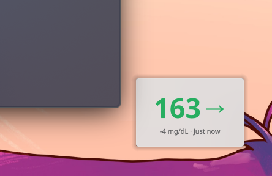

#  Nightscout widget for KDE Plasma 6

[](https://www.opendesktop.org/p/2381783/)

Shows your current glucose value from your [Nightscout](https://nightscout.github.io/) server, right in your Plasma panel or on your desktop.

<table>
  <tr>
    <td align="center"></td>
    <td align="center"></td>
  </tr>
  <tr>
    <td align="center">On the desktop</td>
    <td align="center">In a panel</td>
  </tr>
</table>

## Features

- Current glucose value with trend arrow and change since the last reading (e.g. `112 ↗ +4`)
- mg/dL or mmol/L
- Colour coding: green in range, orange high, red low (limits are configurable)
- Old readings are greyed out and struck through, so you notice when data stops coming in
- Low readings flag the widget as needing attention, so it stays visible even in a collapsed system tray
- Click for a larger view with how long ago the reading was taken
- Middle-click or right-click → *Refresh* to update immediately
- On the desktop, the background can be turned off so the number sits on your wallpaper

## Requirements

Plasma 6 and a Nightscout server.

## Installation

From Plasma: right-click the panel or desktop → *Add Widgets…* → *Get New Widgets…* → *Download New Plasma Widgets* → search for **Nightscout**.

Or download it from the store page: https://www.opendesktop.org/p/2381783/

Manually, from a downloaded `.plasmoid` file:

```sh
kpackagetool6 -t Plasma/Applet -i nightscout-1.0.0.plasmoid
```

## Configuration

Right-click the widget → *Configure Nightscout…*

| Setting | Description |
|---|---|
| Nightscout URL | e.g. `https://my-nightscout.example.com` or `http://192.168.1.10:1337` |
| Access token | Needed if your site is not publicly readable. Create one in Nightscout under *Admin Tools* with the `readable` role. |
| Units | mg/dL or mmol/L |
| Refresh interval | Seconds between updates (default 60) |
| Low / high | Thresholds in mg/dL (default 70 / 180) |
| Stale after | Minutes after which a reading counts as old (default 15) |

The widget reads `/api/v1/entries/sgv.json` and sends the token both as the `token` query parameter and as the `api-secret` header.

## Development

```sh
# install from source
kpackagetool6 -t Plasma/Applet -i package
# update after changes
kpackagetool6 -t Plasma/Applet -u package
# build the .plasmoid for the KDE Store
./build.sh
```

## Disclaimer

This widget is not a medical device. Do not make treatment decisions based on it.

## License

GPL-2.0-or-later
